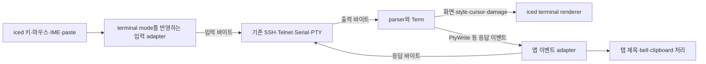

# Alacritty 구성요소 재사용과 terminal 교체 검토

- 검토일: 2026-11-09, 한국 시간 기준입니다.
- ToposWeaver 기준: `d5fb4954377ab1824b8674c6f094a80848c98f71`, 버전 0.1.2입니다.
- 상태: **설계 검토이며 채택·구현 완료를 의미하지 않습니다.** 의존성이나 제품 코드는 변경하지 않았습니다.
- 확인 범위: 로컬 소스, 공식 저장소의 manifest·구현·API 문서와 crates.io metadata입니다. 후보를 연결한 Windows 빌드, GUI·실서버 동작, 성능은 검증하지 않았습니다.
- **확인**은 조회한 소스·API의 사실, **판단**은 ToposWeaver에 대한 적용 제안, **미검증**은 추가 실행이 필요한 항목입니다.

## 검토 결과

**판단:** `alacritty_terminal`의 parser·화면 상태·selection·검색·damage·이벤트를 우선 재사용하고, 기존 connection·`iced` UI·IME·`portable-pty`는 첫 교체에서 유지하는 방안이 적합합니다. 키보드·마우스·붙여넣기는 terminal mode와 연결하도록 보완해야 합니다.

Alacritty renderer와 창·입력 계층을 함께 가져오면 OpenGL·`winit`·앱 내부 타입의 통합 범위가 커집니다. core 교체와 renderer·PTY 교체는 별도 작업으로 검증합니다. `crossfont`와 `copypasta`는 기존 `iced` 기능으로 충족하지 못하는 요구가 확인될 때 검토합니다.

이 검토는 [개발 계획의 K05](development-plan.md#개발-우선순위)에 해당합니다. K03의 서버 신뢰 검증과 K04의 연결 취소·종료 문제는 terminal core 변경과 별도로 남습니다.

## 현재 ToposWeaver와 교체 경계

현재 [terminal.rs](../src/terminal.rs)는 `vte` parser, grid·history·cursor·style·reflow, selection, terminal 응답, Canvas cache·렌더링, IME preedit를 함께 관리합니다. 셀은 `char` 하나와 속성을 보관하고 wide character의 뒤쪽 셀에는 NUL을 사용합니다.

- [model.rs](../src/app/model.rs)는 세션마다 `TerminalEmulator`를 보관합니다.
- [update.rs](../src/app/update.rs)는 출력 바이트 전달, resize·scroll·selection, terminal 응답 회수와 연결 송신을 처리합니다.
- [subscription.rs](../src/app/subscription.rs)는 키·IME 이벤트를 받고 방향키 등 일부 입력을 고정 escape sequence로 만듭니다.
- 붙여넣기는 clipboard 문자열을 바이트로 바꾸어 sender에 보냅니다. core만 교체해도 bracketed paste가 자동 적용되지는 않습니다.
- [windows.rs](../src/platform/windows.rs)는 `portable-pty`로 로컬 셸을 시작하고 입출력·resize를 처리합니다.

**제안하는 데이터 흐름:**

`PtyWrite`라는 이름의 이벤트도 앱 adapter에서 해당 SSH·Telnet·Serial·로컬 연결로 보낼 수 있습니다. RDP·VNC의 원격 화면·입력 경로는 이번 교체 대상에 포함하지 않습니다.

## Alacritty 패키지 구조

**확인:** `alacritty`와 `alacritty_terminal`은 같은 workspace의 별도 패키지이며, 전자가 후자에 의존합니다. `alacritty_terminal`은 `alacritty` crate의 하위 모듈이 아닙니다. 공식 workspace는 아래 네 패키지로 구성됩니다. [workspace manifest](https://github.com/alacritty/alacritty/blob/aa5d942f46c40184a3f214830ff5f7989f4733a1/Cargo.toml)

| 패키지 | crates.io 안정 버전 | 역할 | 적용 판단 |
|---|---|---|---|
| `alacritty_terminal` | 0.26.0 | Terminal core, PTY·I/O 기반입니다. | 우선 도입 검증 대상입니다. |
| `alacritty_config` | 0.2.3 | 설정값 교체·병합 등의 추상화입니다. | 현재 JSON 저장 구조에서 우선순위가 낮습니다. |
| `alacritty_config_derive` | 0.2.5 | `ConfigDeserialize`·`SerdeReplace` derive macro입니다. | 설정 처리 방식을 바꿀 때 검토합니다. |
| `alacritty` | 0.17.0 | UI·입력·renderer·설정을 결합한 실행 프로그램입니다. | 그대로 임베딩하는 공개 라이브러리로 제공되지 않습니다. |

조회한 개발 브랜치의 `alacritty_terminal` 버전은 `0.26.1-dev`입니다. 안정 버전 0.26.0과 구분하며, 개발 브랜치의 모든 API가 안정 버전에 있다고 가정하지 않습니다. 안정 0.26.0의 최소 Rust 버전은 1.85.0, 라이선스는 Apache-2.0입니다. [안정 패키지](https://crates.io/crates/alacritty_terminal/0.26.0), [개발 manifest](https://github.com/alacritty/alacritty/blob/aa5d942f46c40184a3f214830ff5f7989f4733a1/alacritty_terminal/Cargo.toml)

## 바로 활용할 수 있는 terminal API

아래 항목은 `alacritty_terminal 0.26.0`의 공개 API입니다. [모듈 목록](https://docs.rs/alacritty_terminal/0.26.0/alacritty_terminal/), [Term API](https://docs.rs/alacritty_terminal/0.26.0/alacritty_terminal/term/struct.Term.html)

| 구성요소 | 제공 범위 | ToposWeaver 연결 지점 |
|---|---|---|
| `term`, `grid`, `index` | 화면·cursor·history·mode·alternate screen·resize와 좌표 타입입니다. | 자체 terminal 상태와 제어 시퀀스 의미 처리를 대체합니다. |
| `selection`, `vi_mode` | 선택 영역·텍스트 추출·키보드 탐색입니다. | selection·복사·탐색 UI와 연결합니다. |
| `term::search` | 정규식 등 terminal 내용 검색입니다. | 검색창·일치 항목 이동·강조 UI는 별도로 구현합니다. |
| `renderable_content`, `damage`, `reset_damage` | 표시할 내용과 변경 영역입니다. | `iced` renderer가 소비합니다. 선택·IME 등 UI 변경도 별도로 추적합니다. |
| `event` | `PtyWrite`, `Title`, `Bell`, `Wakeup`, clipboard·색상·크기 요청 등입니다. | 앱 메시지·연결 송신·OS 기능으로 변환합니다. |
| `tty`, `event_loop` | 플랫폼별 PTY와 로컬 프로세스 I/O 루프입니다. | 기존 `portable-pty`와 별도로 비교합니다. |
| 재노출된 `vte` | core와 함께 사용하는 parser·ANSI 기반입니다. | core가 사용하는 API·버전에 맞춰 연결합니다. |

**판단:** 자체 alternate screen·scrolling·selection·검색·경계 처리를 계속 확장하는 부담을 줄일 수 있습니다. 다만 변경 영역 API를 사용하는 것만으로 화면 성능이 개선되는 것은 아닙니다. renderer가 해당 정보를 활용해야 합니다.

**미검증:** 기존 terminal 회귀, 한글 reflow, 결합 문자·emoji·grapheme, 실제 TUI 호환성입니다. Alacritty 앱에서의 동작을 ToposWeaver 통합 결과로 대신하지 않습니다.

## 별도 crate로 재사용할 수 있는 주변 기능

이들은 네 패키지 workspace와 별도 저장소에서 제공되며, Alacritty가 사용하는 라이브러리입니다.

| 라이브러리 | 제공 기능 | 적용 판단 |
|---|---|---|
| `crossfont` | 폰트 로딩·metrics·glyph rasterization입니다. Windows DirectWrite, macOS CoreText, 그 외 FreeType 계층을 사용합니다. | 직접 glyph atlas와 renderer를 만들 때 검토합니다. 기존 `iced` 텍스트 경로와 중복되는지 먼저 확인합니다. |
| `copypasta` | 플랫폼별 clipboard 접근입니다. | 우선 Alacritty 이벤트를 기존 `iced::clipboard`에 연결하고, 부족한 요구가 확인되면 도입합니다. |
| `vte` | 제어 시퀀스 parser입니다. | 이미 사용 중이며, 이것만으로 화면·history·mode가 완성되지는 않습니다. |

[crossfont API](https://docs.rs/crossfont/0.9.0/crossfont/), [copypasta API](https://docs.rs/copypasta/0.10.2/copypasta/), [Alacritty 의존성 manifest](https://github.com/alacritty/alacritty/blob/aa5d942f46c40184a3f214830ff5f7989f4733a1/alacritty/Cargo.toml)

`crossfont`는 glyph cache·GPU atlas·renderer 전체를 제공하지 않습니다. Rust 인터페이스를 제공하더라도 native font engine 의존성은 남습니다. 버전도 구분해야 합니다. 조회한 crossfont 최신 안정 버전은 0.9.0이지만 위 Alacritty 개발 manifest는 0.8.1을 요구합니다.

`alacritty_config`는 설정 파일 탐색·감시·자동 저장을 모두 제공하는 설정 관리자가 아닙니다. `SerdeReplace` 등 값 교체·병합 기반과 derive macro를 제공하며, 앱의 설정 schema·파일 감시·마이그레이션은 별도 코드입니다. 현재 JSON 저장을 유지한다면 도입 필요성이 낮습니다. [설정 추상화](https://github.com/alacritty/alacritty/blob/aa5d942f46c40184a3f214830ff5f7989f4733a1/alacritty_config/src/lib.rs), [derive macro](https://github.com/alacritty/alacritty/blob/aa5d942f46c40184a3f214830ff5f7989f4733a1/alacritty_config_derive/src/lib.rs)

## 소스 분리·수정이 필요한 앱 내부 기능

`alacritty`는 `main.rs`에서 아래 기능을 내부 모듈로 구성합니다. 내부 함수의 `pub` 표기만으로 외부 라이브러리 API가 되는 것은 아닙니다. 소스를 분리해 재사용하면 의존성 수정과 upstream 변경 추적을 함께 맡게 됩니다. [앱 모듈 구성](https://github.com/alacritty/alacritty/blob/aa5d942f46c40184a3f214830ff5f7989f4733a1/alacritty/src/main.rs)

| 기능 | 현재 결합 | 적용 판단 |
|---|---|---|
| GPU renderer·glyph cache·atlas | OpenGL·`glutin`, 앱의 화면·설정 타입과 연결됩니다. | `iced`·`wgpu`에 그대로 붙일 수 없습니다. core 교체와 분리합니다. |
| 키보드 sequence·binding·입력 정책 | `winit` 이벤트와 앱의 config·display·scheduler에 연결됩니다. | mode에 따른 인코딩 로직을 참고하거나 부분 이식할 가치가 있습니다. |
| IME 처리 | 키 입력·preedit·창·display 상태에 연결됩니다. | 기존 `iced` IME 경로를 유지하고 조합 중 키 중복·후보 창 위치를 검증합니다. |
| 설정 파일 감시·마이그레이션 | Alacritty의 설정 schema·파일 로딩·앱 상태에 연결됩니다. | 현재 설정 구조에 필요한 기능만 별도 구현합니다. |
| 검색 UI·URL hint·시각적 bell | display·입력·앱 상태에 연결됩니다. | core API와 ToposWeaver UI를 연결하는 방식으로 구현합니다. |

[Renderer 구현](https://github.com/alacritty/alacritty/blob/aa5d942f46c40184a3f214830ff5f7989f4733a1/alacritty/src/renderer/mod.rs), [키보드 구현](https://github.com/alacritty/alacritty/blob/aa5d942f46c40184a3f214830ff5f7989f4733a1/alacritty/src/input/keyboard.rs)

**미검증:** core 교체 후 처리량·메모리·입력 지연입니다. Alacritty 앱의 renderer·스레드 구조를 사용하지 않는 구성에 앱 성능 수치를 적용하지 않습니다.

## 다른 후보와의 비교

| 후보 | 확인한 사실 | 적용 판단 |
|---|---|---|
| `iced_term` 0.8.0 | Rust 위젯이며 `iced 0.14.0`, `alacritty_terminal 0.25.1`을 사용합니다. 생성 시 자체 PTY를 시작하고 `Write`는 PTY로 입력을 보냅니다. 위젯 API 안정성을 보장하지 않습니다. | 버전 조건은 맞지만 외부 SSH·Serial 출력 주입과 송신 분리가 필요합니다. 렌더링·입력 구현의 참고 또는 수정 기반으로 검토합니다. |
| `wezterm-term` | Rust core이며 `advance_bytes` 입력과 앱이 제공하는 `std::io::Write` 출력을 지원합니다. crates.io 패키지 조회는 404였고 저장소의 여러 내부 crate에 의존합니다. | transport 경계는 적합하지만 Git revision·내부 의존성 관리 비용을 비교해야 합니다. |
| `libghostty-vt` | 구현 언어는 Zig이며 C API를 제공합니다. 화면 그리기와 PTY 연결은 소비자가 맡습니다. | Rust 구현이 요구사항이라면 우선순위가 낮아집니다. 채택 시 FFI·Zig 빌드·렌더링 통합을 별도로 검증해야 합니다. |

`iced_term`의 조회한 위젯 코드에서는 `InputMethod` preedit·commit과 `request_input_method` 처리를 확인하지 못했습니다. 한글 입력 실패를 실측한 결과는 아니며, ToposWeaver의 IME 동작을 대체할 수 있다고 가정하지 않습니다.

[iced_term manifest](https://github.com/kemokempo/iced_term/blob/5153ba43ea98f84fc980453e08345d4b5e2c4e8b/Cargo.toml), [backend](https://github.com/kemokempo/iced_term/blob/5153ba43ea98f84fc980453e08345d4b5e2c4e8b/src/backend.rs), [위젯](https://github.com/kemokempo/iced_term/blob/5153ba43ea98f84fc980453e08345d4b5e2c4e8b/src/view.rs), [README](https://github.com/kemokempo/iced_term/blob/5153ba43ea98f84fc980453e08345d4b5e2c4e8b/README.md), [WezTerm core 설명](https://github.com/wezterm/wezterm/blob/458a100c1bf4134d36cb5c42dd90e4c8266d9e1a/term/README.md), [WezTerm 의존성](https://github.com/wezterm/wezterm/blob/458a100c1bf4134d36cb5c42dd90e4c8266d9e1a/term/Cargo.toml), [libghostty-vt API](https://github.com/ghostty-org/ghostty/blob/vt-1.0.0/include/ghostty/vt/terminal.h)

## 도입 순서와 채택 조건

아래는 제안이며 완료 목록이 아닙니다. 기존 설계·코딩 스타일을 우선하고, K01·K02에서 추가한 회귀 입력은 유지합니다.

1. **core adapter를 검증합니다.** `alacritty_terminal 0.26.0`의 dependency resolution과 Windows MSVC 컴파일을 확인하고, 출력 바이트·resize·화면 데이터·terminal 응답의 경계를 만듭니다. 기존 connection과 `portable-pty`를 유지합니다.
2. **기존 화면을 연결합니다.** history·cursor·style·selection·scrollbar를 `iced`에 표시합니다. 기존 테스트에서 자체 grid를 직접 검사하는 부분은 관측 가능한 화면·cursor 결과를 검사하도록 조정합니다.
3. **입력을 연결합니다.** application cursor/keypad·modifier·F-key·mouse reporting·bracketed paste·focus와 IME를 검증합니다. 출력 parser 교체만으로 입력 구현을 완료 처리하지 않습니다.
4. **실사용과 성능을 비교합니다.** PowerShell·CMD·SSH의 vim/less/top/tmux, Telnet·Serial 회귀, 한글·결합 문자·emoji, 반복 resize·탭 종료를 확인합니다. 같은 Release 설정·출력·history 조건에서 CPU·메모리·입력 지연을 측정합니다.
5. **제거 범위를 결정합니다.** 필요한 동작과 배포 검증이 통과한 뒤 기존 performer·grid·ConPTY 보정을 제거합니다. 현재 보정을 새 core에 그대로 적용하지 않고, 기록한 출력으로 필요 여부를 다시 판정합니다.

채택 조건은 다음과 같습니다.

- [ ] 기존 ECH·행 끝·wide cell·resize 회귀가 통과하고 alternate screen 복원이 동작합니다.
- [ ] terminal 응답과 입력이 해당 세션으로 전달되며 이중 전송·누락이 없습니다.
- [ ] 한글 IME preedit·commit·후보 창 위치, 복사·붙여넣기·선택이 동작합니다.
- [ ] 실제 TUI와 Windows ConPTY에서 화면·입력·resize 결과를 기록했습니다.
- [ ] 연결·인증·EOF·취소·종료의 기존 문제와 새 회귀를 구분했습니다.
- [ ] 다중 세션·대량 출력 성능을 기존 구현과 비교하고 결과를 기록했습니다.
- [ ] lockfile·사용 API·라이선스 고지·Windows 배포 절차가 재현 가능합니다.

## 출처와 검증 기록 관리

버전 수치는 2026-11-09 crates.io 조회값입니다. 도입 시점에는 안정 버전·최소 Rust·변경 내역을 다시 확인합니다. 위의 외부 구현 링크는 조회한 commit으로 고정했으며, 개발 소스와 crates.io 안정 패키지의 차이는 도입 검증에서 확인합니다.

- Alacritty 소스: `aa5d942f46c40184a3f214830ff5f7989f4733a1`입니다.
- iced_term 소스: `5153ba43ea98f84fc980453e08345d4b5e2c4e8b`입니다. 이전 `Harzu/iced_term` 주소는 조회 시 `kemokempo/iced_term`으로 연결되었습니다.
- WezTerm 소스: `458a100c1bf4134d36cb5c42dd90e4c8266d9e1a`입니다.
- crates.io 조회: [alacritty](https://crates.io/api/v1/crates/alacritty), [alacritty_terminal](https://crates.io/api/v1/crates/alacritty_terminal), [alacritty_config](https://crates.io/api/v1/crates/alacritty_config), [alacritty_config_derive](https://crates.io/api/v1/crates/alacritty_config_derive), [iced_term](https://crates.io/api/v1/crates/iced_term), [wezterm-term](https://crates.io/api/v1/crates/wezterm-term)입니다.

실제 채택 결과는 [개발·검증 계획](development-plan.md)의 K05 및 검증 기록에 날짜·commit·target·환경·통과/실패/미검증을 구분해 남깁니다. 이 문서의 제안을 구현 완료로 옮기지 않습니다.
